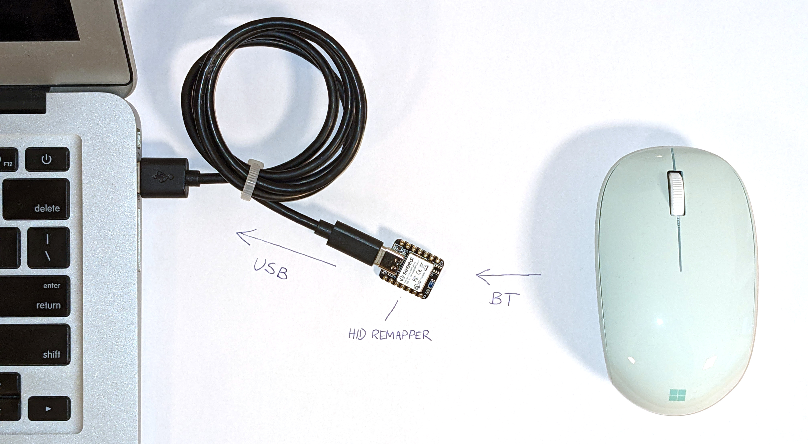

# Bluetooth version

_(Please note this is a somewhat less tested path than the regular USB version of HID Remapper. Especially the Bluetooth Classic variant is fairly new.)_

There are two special versions of HID Remapper that take inputs from Bluetooth devices and translate them to USB. They are different from most Bluetooth USB dongles in that from the computer's point of view, they look like a USB mouse/keyboard/gamepad, so they require no special drivers. The remapping functionality works as usual. You can connect multiple Bluetooth devices at the same time.



The versions differ in what boards they run on and what Bluetooth devices they are compatible with.

The version that runs on the Pico W or Pico 2W works only with Bluetooth Classic devices.

The version that runs on boards with the nRF52840 chip only works with Bluetooth LE devices.

Bluetooth Classic and Bluetooth LE are two separate protocols. Computers, phones, tablets, etc. speak both, but mice, keyboards, game controllers, etc. typically only speak one or the other.

You can usually tell that a device uses Bluetooth LE if the documentation says it requires Bluetooth version 4 or 5, but some devices say they use Bluetooth 4 or 5 and still use Bluetooth Classic (which isn't wrong as Bluetooth Classic is still part of the newer spec).

You can install Nordic's [nRF Connect app](https://www.nordicsemi.com/Products/Development-tools/nRF-Connect-for-mobile) on your phone or tablet, put your device in pairing mode and try scanning for it from the app. If it shows up in the scan then it uses Bluetooth LE, if not then it probably uses Bluetooth Classic.

If your device is paired to a Windows PC, you can also use these commands in PowerShell to check. The first command lists Bluetooth Classic devices, the second lists Bluetooth LE devices.
```
Get-PnpDevice | Where-Object InstanceId -like 'BTHENUM*'
Get-PnpDevice | Where-Object InstanceId -like 'BTHLE*'
```

## Pairing devices

To connect Bluetooth devices to the remapper, you need to put the device in pairing mode. This is device-specific, but usually involves holding a button for a few seconds. Then you also need to put HID Remapper in pairing mode. You do this by either pressing the "user" button on the board or by clicking the "Pair new device" button on the web configuration tool. See below for boards that don't have a button. The remapper will also automatically enter pairing mode if no devices are currently paired.

You can tell the remapper is in pairing mode if the status LED is lit constantly. When it's not in pairing mode, the status LED will be blinking, with the number of blinks per cycle corresponding to the number of currently connected devices. See below for boards that don't have a status LED.

To make the remapper forget all currently paired devices, hold the "user" button for over 3 seconds, or click the "Forget all devices" button on the web configuration tool.

## Bluetooth Classic (Pico W, Pico 2W)

This version runs on the Raspberry Pi Pico W and Pico 2W boards. You flash the firmware the usual way: hold the BOOTSEL button while connecting the board to your computer, then copy the correct UF2 file to the "RPI-RP2" or "RP2350" drive that shows up. Use [remapper_bt.uf2](https://github.com/jfedor2/hid-remapper/releases/latest/download/remapper_bt.uf2) for the Pico W and [remapper_bt_pico2_w.uf2](https://github.com/jfedor2/hid-remapper/releases/latest/download/remapper_bt_pico2_w.uf2) for the Pico 2W.

If you want to flash a newer version of the firmware in the future, you can also put the board in firmware flashing mode using the HID Remapper [web configuration tool](https://www.remapper.org/config/).

## Bluetooth LE (nRF52840 boards)

This version runs on boards with Nordic's nRF52840 chip. Currently precompiled binaries are available for the following boards:

* [Adafruit Feather nRF52840 Express](https://www.adafruit.com/product/4062)
* [Seeed Studio Xiao nRF52840](https://www.seeedstudio.com/Seeed-XIAO-BLE-nRF52840-p-5201.html)
* [nice!nano](https://nicekeyboards.com/nice-nano/)

To flash the firmware, first put the board in flashing mode by double clicking the reset button quickly. A drive should appear on your computer. Copy the [UF2 file that matches your board](https://github.com/jfedor2/hid-remapper/releases/latest) to that drive and that's it. If you want to flash a newer version of the firmware in the future, you can also put the board in firmware flashing mode using the HID Remapper [web configuration tool](https://www.remapper.org/config/).

(If your board doesn't have a reset button, the same result can be achieved by shorting its reset pin to GND with tweezers or a piece of wire.)

## Boards without a button or LEDs

Some boards don't have a button or have no LEDs or only have one. On those boards you can use the configuration website to enter pairing mode and forget paired devices. You can also wire your own button or LED, the table below shows the correct pins on each board. The LED should go from that pin to GND through a resistor, the button should connect that pin to GND when pressed (you can also just short the pin to GND with a piece of wire).

board | button pin | status LED pin | activity LED pin
----- | ---------- | -------------- | ----------------
Xiao nRF52840 | D0 | built-in | built-in
nice!nano | 017 | built-in | 020
Pico W / 2W | GPIO2 | GPIO3 | GPIO4

## Known issues and limitations

* When using custom usages to work around broken report descriptors, on the Bluetooth Classic version matching by VID/PID doesn't work (you can still create custom usages that apply to all devices).
* GPIO input/output functionality is not available on the Bluetooth LE variant.
* The Bluetooth LE variant can't function as a boot protocol keyboard, so it won't work in some older BIOSes or bootloaders.
