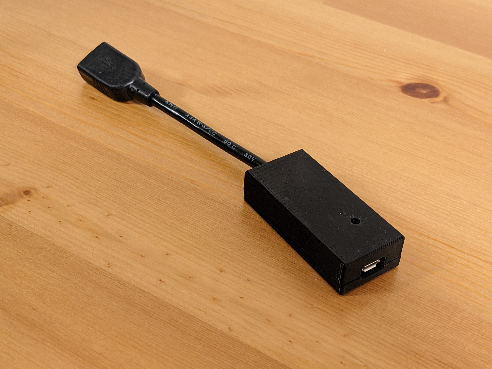

# HID Remapper

_For user documentation please see the project's website at [remapper.org](https://www.remapper.org/)._

This is a configurable USB dongle that allows you to remap inputs from mice, keyboards and other devices. It works completely in hardware and requires no software running on the computer during normal use.

It can do things like reassign buttons, change keyboard layouts, map mouse buttons to keyboard inputs, map keystrokes to mouse inputs, change mouse sensitivity (permanently or when a button is held), rotate mouse axes by arbitrary (non-90 degree) angles, drag-lock for mouse buttons, scroll by moving the mouse, and much more.

It is configurable [through a web browser](https://www.remapper.org/config/) using WebHID (Chrome or Chrome-based browser required).

Wireless receivers are supported and multiple devices can be connected at the same time using a USB hub (with different mappings for each device if desired).

In addition to the remapping functionality, it can do polling rate overclocking up to 1000 Hz.

A separate [serial](SERIAL.md) version of the remapper takes inputs from a serial (RS-232) mouse and translates them to USB.

There's also a [Bluetooth](BLUETOOTH.md) version that runs on nRF52840-based boards, which translates Bluetooth inputs to USB.



## How to make the device

There are three main ways of making the HID Remapper. You can either buy [this board](https://www.adafruit.com/product/5723) from Adafruit, make it yourself using a Raspberry Pi Pico (or two), or you can use the provided files to manufacture a custom board at JLCPCB or a similar service. The functionality is the same in all cases.

If you get the Feather RP2040 USB Host board from Adafruit, the device is ready to use, you just need to flash it with the right firmware ([remapper\_feather.uf2](https://github.com/jfedor2/hid-remapper/releases/latest/download/remapper_feather.uf2)). Hold the "Boot" button on the board, then press the "Reset" button. A USB drive should show up on your computer. Copy the UF2 file to that drive. That's it.

See [here](HARDWARE.md) for details on how to make the Pico variants of the device and [here](custom-boards/) for details on the custom board option.

## How to use the configuration tool

A live version of the web configuration tool can be found at [remapper.org/config](https://www.remapper.org/config/).

For details on how to use it, please see the [HID Remapper Manual](https://www.remapper.org/manual/).

If you can't use the browser-based configuration tool, there's also a [command-line tool](config-tool) that takes JSON in the same format as the web tool on standard input. I only tested it on Linux, but in theory it should also run on Windows and Mac.

## How to update the firmware

The procedure to update the firmware is similar on all variants. When you go to the configuration website and try to connect to your device when it doesn't have the latest firmware, you will get a message and a link to a version of the configuration interface that is compatible with your current (old) firmware. Click that link, connect to your HID Remapper by clicking "Open device" as usual, then go to the "Actions" tab and click "Flash firmware". This will put your device in firmware flashing mode. A drive should appear on your computer. For all the RP2040-based variants, the drive will be named "RPI-RP2". For the Bluetooth variants, it will be called something else, depending on what board you're using. Download the correct firmware file for your variant (see table below) and copy it to that drive. On custom boards v1, v2, v5, v6 and v7 (dual RP2040 boards), after flashing the firmware you have to disconnect and reconnect your HID Remapper. That's it, you can go back to the regular version of the configuration interface and carry on.

_(Please note that previously a manual "Flash B side" step was required on custom boards v1, v2, v5, v6 and v7. That is no longer necessary.)_

If you're using the dual Pico variant then you need to flash the A side using the [remapper\_dual\_a.uf2](https://github.com/jfedor2/hid-remapper/releases/latest/download/remapper_dual_a.uf2) file as described above and then flash the B side manually. Disconnect your HID Remapper from your computer, disconnect the OTG adapter from the B-side Pico, hold the BOOTSEL button on the B-side Pico and then, while holding the button, connect the B-side Pico to your computer. A drive named "RPI-RP2" should appear. Copy the [remapper\_dual\_b.uf2](https://github.com/jfedor2/hid-remapper/releases/latest/download/remapper_dual_b.uf2) file to that drive. Disconnect the B-side Pico from your computer, reconnect the OTG adapter and reconnect your HID Remapper to your computer.

When updating firmware, the current configuration on your HID Remapper is preserved. For extra peace of mind you can export your configuration to a JSON file before performing the update. That way if you need to revert to the old version of the firmware for any reason, you'll be able to import the configuration from the JSON file (configuration is lost when going from a newer firmware to an older firmware).

variant | firmware file(s) | notes
------- | ---------------- | -----------------------
single Pico | [remapper.uf2](https://github.com/jfedor2/hid-remapper/releases/latest/download/remapper.uf2) |
dual Pico | [remapper\_dual\_a.uf2](https://github.com/jfedor2/hid-remapper/releases/latest/download/remapper_dual_a.uf2)<br>[remapper\_dual\_b.uf2](https://github.com/jfedor2/hid-remapper/releases/latest/download/remapper_dual_b.uf2) | each Pico needs to be flashed separately
Feather RP2040 with USB Host | [remapper\_feather.uf2](https://github.com/jfedor2/hid-remapper/releases/latest/download/remapper_feather.uf2) |
custom board v1 | [remapper\_board.uf2](https://github.com/jfedor2/hid-remapper/releases/latest/download/remapper_board.uf2) | disconnect and reconnect after flashing
custom board v2 | [remapper\_board.uf2](https://github.com/jfedor2/hid-remapper/releases/latest/download/remapper_board.uf2) | disconnect and reconnect after flashing
custom board v3 | [remapper\_feather.uf2](https://github.com/jfedor2/hid-remapper/releases/latest/download/remapper_feather.uf2) |
custom board v4 | [remapper\_feather.uf2](https://github.com/jfedor2/hid-remapper/releases/latest/download/remapper_feather.uf2) |
custom board v5 | [remapper\_board.uf2](https://github.com/jfedor2/hid-remapper/releases/latest/download/remapper_board.uf2) | disconnect and reconnect after flashing
custom board v6 | [remapper\_board.uf2](https://github.com/jfedor2/hid-remapper/releases/latest/download/remapper_board.uf2) | disconnect and reconnect after flashing
custom board v7 | [remapper\_board\_v7.uf2](https://github.com/jfedor2/hid-remapper/releases/latest/download/remapper_board_v7.uf2) | disconnect and reconnect after flashing
custom board v8 | [remapper\_board\_v8.uf2](https://github.com/jfedor2/hid-remapper/releases/latest/download/remapper_board_v8.uf2) |
Feather nRF52840 Express | [remapper_adafruit_feather_nrf52840.uf2](https://github.com/jfedor2/hid-remapper/releases/latest/download/remapper_adafruit_feather_nrf52840.uf2) |
Xiao nRF52840 | [remapper_seeed_xiao_nrf52840.uf2](https://github.com/jfedor2/hid-remapper/releases/latest/download/remapper_seeed_xiao_nrf52840.uf2) |
serial | [remapper_serial.uf2](https://github.com/jfedor2/hid-remapper/releases/latest/download/remapper_serial.uf2) |

For boards not listed above, use the same file name you used when flashing it for the first time.

## How to compile the firmware

The easiest way to compile the firmware is to let GitHub do it for you. This repository has GitHub Actions that build the firmware, so you can just fork, make your changes, wait for the job to complete, and look for the binaries in the artifacts produced.

To compile the RP2040 firmware on your machine, use the following steps (details may vary depending on your Linux distribution):

```
sudo apt install gcc-arm-none-eabi libnewlib-arm-none-eabi libstdc++-arm-none-eabi-newlib srecord
git clone https://github.com/jfedor2/hid-remapper.git
cd hid-remapper
git submodule update --init
cd firmware
mkdir build
cd build
cmake ..
# or, to build for the custom boards:
# PICO_BOARD=remapper cmake ..
make
```

To compile the nRF52 firmware, you can either follow [Nordic's setup instructions](https://docs.nordicsemi.com/bundle/ncs-latest/page/nrf/installation.html) and then `west build -b seeed_xiao_nrf52840` to compile the firmware, or you can use Docker with a command like this (start from the top level of the repository or adjust the path accordingly):

```
docker run --rm -v $(pwd):/workdir/project -w /workdir/project/firmware-bluetooth nordicplayground/nrfconnect-sdk:v2.2-branch west build -b seeed_xiao_nrf52840
```

The nRF52 firmware can be built for `adafruit_feather_nrf52840`, `seeed_xiao_nrf52840` or `nice_nano`.

## Debugging the Bluetooth version

If a Bluetooth device connects but its inputs don't come through, start with these checks:

1. Open the Monitor tab in the [web configuration tool](https://www.remapper.org/config/) and use the device. If its inputs appear there, the Bluetooth connection is fine and the problem is in your mappings or on the USB side.
2. Make sure the device isn't also connected to something else. If it's a ZMK keyboard, unplug it from USB (or select Bluetooth output with `&out OUT_BLE`), select the profile that's paired with the remapper, and on a split keyboard pair with the central half.
3. Click "Forget all devices", remove the remapper from the device's own list of paired devices, then click "Pair new device" and pair again. A pairing that only one side remembers will fail at the encryption step.
4. Check the status LED for a blink code, as described below.

### LED error codes

If connection setup fails, the blue status LED stops showing the normal status and repeats a blink code instead: a group of slow blinks, a one second pause, then a group of fast blinks. The code stays until the next device connects, or until you click "Forget all devices".

The number of slow blinks is the last step that passed, and any fast blinks mean that the next step failed:

Slow blinks | Last step that passed | Fast blinks mean this step failed
----------- | --------------------- | ---------------------------------
1 | scanning | connecting to the device
2 | Bluetooth connection established | encryption or pairing
3 | connection encrypted | finding the device's HID service
4 | HID service found | HID setup
5 | subscribed to input reports | reading the report descriptor
6 | report descriptor read | no fast blinks at this step
7 | input report received | no fast blinks at this step

The number of fast blinks is the error code, capped at 30:

Code | Meaning
---- | -------
4 slow, 22 fast | the device's report types don't match their properties in a way the firmware can't correct
4 slow, 30 fast | an error code of 30 or higher, usually a HID information, report reference or protocol mode value of an unexpected size
3 slow, 2 fast | the device doesn't have a HID service
5 slow, 30 fast | the report descriptor is longer than the 512 bytes the firmware can store
4 slow, 5 or 15 fast | the device says the connection isn't secure enough (authentication or encryption)

Fast blink counts from 2 slow blinks are Zephyr's `bt_security_err` values. Other counts from 4 slow blinks are usually Bluetooth ATT error codes returned by the device.

The fast blinks are hard to count by eye, so it helps to film them. Each one takes about 0.22 seconds.

### Debug build

A debug build shows the current step all the time, so you can also see how far a working connection gets. For example, it will show 6 slow blinks once setup is complete, then 7 after the first input report arrives. If it stays at 6 while you use the device, setup worked but the device isn't sending anything. If it reaches 7 and the Monitor tab stays empty, reports are arriving but aren't being parsed.

To compile it, add `-- -DREMAPPER_DEBUG_STAGES=1` to the build command:

```
docker run --rm -v $(pwd):/workdir/project -w /workdir/project/firmware-bluetooth nordicplayground/nrfconnect-sdk:v2.2-branch west build -b nice_nano -- -DREMAPPER_DEBUG_STAGES=1
```

The firmware also writes logs to the board's serial TX pin at 921600 baud, if you have a USB serial adapter.

## License

The software in this repository is licensed under the [MIT License](LICENSE), unless stated otherwise.

The hardware designs in this repository are licensed under the Creative Commons Attribution 4.0 International license ([CC BY 4.0](https://creativecommons.org/licenses/by/4.0/)), unless stated otherwise.
